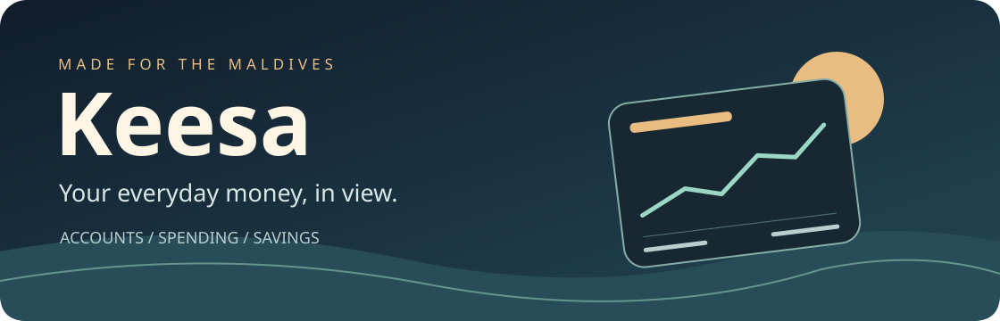
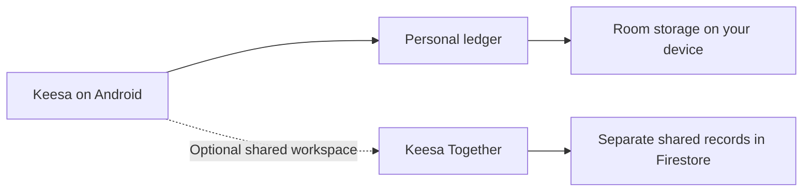

  

  

  <a href="#inside-keesa"><strong>Explore the app</strong></a> ·
  <a href="#release-tracks"><strong>Release tracks</strong></a> ·
  <a href="#install-a-pilot"><strong>Install a pilot</strong></a> ·
  <a href="#development-tracker"><strong>Development tracker</strong></a>

## Inside Keesa

Keesa brings bank accounts, cash wallets, savings goals, and upcoming payments into one Android ledger built for the Maldives. See what you can spend after setting money aside, and follow your finances in **MVR, USD, or a combined view**.

| **Track your money** | **Plan ahead** | **Share with a partner** |
| :--- | :--- | :--- |
| [Accounts, transfers, receipts, and bank SMS](#accounts-and-everyday-ledger) | [Budgets, goals, bills, and financing](#planning-and-insights) | [Private and joint finances in Keesa Together](#keesa-together) |

### Accounts and everyday ledger

- **Bank accounts and wallets.** Open an account’s balance from Home, choose MVR-only or combined MVR + USD for the main spendable amount, and set a custom conversion rate. Historical transactions retain their recorded rate.
- **Income, expenses, and transfers.** Move money between your own accounts without counting it as income or spending. For cross-currency transfers, record the actual amounts sent and received and keep the resulting exchange rate.
- **Top Up and Adjust Balance.** Distinguish new income from funds you already held. Reconcile an account to its actual balance with a dated correction and a reason, preserving the original ledger and keeping the correction out of income and spending reports.
- **Receipts and beneficiaries.** Attach receipt images, split a purchase across categories, and view the income and expenses linked to each beneficiary. Record income from a beneficiary directly into one of your accounts.
- **Ledger housekeeping.** Archive entries to hide them from the active ledger while retaining their financial effect. Trash and refund actions are available for eligible transactions.

<strong>Bank SMS automation and review</strong>

With permission, Keesa parses supported bank alerts on the device. Choose automatic posting or review alerts yourself, individually or in bulk. New alerts are the default, with an optional scan from a date you select. You can choose a default account and whether bank-account matching takes priority. An outgoing transfer can debit its source while the destination remains pending, then be completed from the ledger.

### Planning and insights

| Feature | What you can do |
| :--- | :--- |
| **Budgets and spending envelopes** | Set monthly limits by category, track what you’ve used, and see what’s left. Split receipts count toward the categories you assigned. |
| **Goal Vaults** | Account-backed reservations with contribution/withdrawal history, a dashboard, categories, priorities, target dates, images, optional schedules and lifecycle controls. Personal or shared ownership keeps spendable money separate. Allocate salary toward goals, envelopes, or other accounts. |
| **Subscriptions and commitments** | View upcoming payments in a calendar or list, check daily agendas and payment status, and log subscription renewals when you pay. |
| **Loans and financing** | Track facilities, due dates, linked debit accounts, and repayments. Use conventional APR or Murabaha calculations when setting up a facility and maintain the outstanding balance manually. |
| **Spending intelligence** | Explore MVR, USD, and combined trends. See which categories drove changes, how recurring payments add up, and how quickly envelopes are being used. Tap through to the supporting transactions. |
| **Optional notifications** | Get on-device alerts for budget thresholds, upcoming subscriptions, unusual spending, and goal milestones. Unusual-spending alerts use your local history when enough is available. |

### Pilot updates

Keesa checks the public GitHub pilot channel about once a day, with a manual **Check for updates** action in **Settings → About Keesa**. See the version and release notes before downloading, follow download progress, and install through Android’s confirmation screen. Downloads are checked against their published SHA-256, package, version, and the installed signing certificate. Updates are optional, and dismissed versions stay dismissed during automatic checks.

The first updater-enabled build needs to be installed manually over the existing app. Android may ask you to allow Keesa to install unknown apps before a later update.

### Keesa Together

Keep your private finances and a two-person household workspace in one app. Switch between **Personal**, **Together**, and **All**. The combined view labels private and shared items and lets you filter by space.

- **Set up a workspace.** Sign up with email, verify your address, and create an expiring invite code for your partner. They enter the code and you confirm the request. Email verification can be resent, and password reset is available.
- **Manage household finances.** Use shared accounts, transactions, beneficiaries, budgets, envelopes, Goal Vaults, subscriptions, a commitments calendar, loans, and spending reports. Either partner can add shared accounts after setup. Partner updates arrive while the app is in the foreground.
- **Share deliberately.** Publish a balance-neutral reference from a private transaction while keeping the original in your Personal ledger. A Personal-to-Together transfer instead moves money into a shared account and shows your partner the contributor, received amount, currency, and date. Your personal account details and private notes stay private. SMS transactions start in Personal.
- **Return to Personal.** Both partners must approve permanent workspace deletion when two people are connected. Once deletion is confirmed, Keesa returns to Personal and keeps your private records and email sign-in.

<strong>App lock, backups, and appearance</strong>

- **App lock.** Set a local PIN, configure inactivity locking, and enable fingerprint unlock on supported devices. The Danger Zone offers a separate PIN-confirmed option to clear this device’s Keesa data.
- **Backup and portability.** Export or import ledger data using CSV and JSON, export a readable financial statement, or use a passphrase-encrypted vault to back up and restore the financial database. Receipt images and app preferences are stored separately from the vault backup.
- **Make it yours.** Choose light, dark, or system appearance, a palette, and a textured slate, custom color, or photo background. Adjust brightness with a live preview and apply settings to one space or across spaces. Replay the illustrated onboarding tour from Settings.

## Development tracker

The [Keesa development tracker](https://keesa.ct.ws/) is the public home for project updates, releases, and community feedback.

  
  
  

  
  
  

## Release tracks

| Track | Version | Where to look |
| :--- | :--- | :--- |
| **Device pilot** | **2.8.0 · Anchored Horizons** | [Pilot APK and release notes](https://github.com/solah438-hub/Keesa/releases/tag/v2.8.0-pilot) |

<strong>What changed in Anchored Horizons</strong>

Goal Vaults now have a dedicated dashboard, account-backed contributions, original-source withdrawals and an attributed history. Add categories, priority, target dates, descriptions, photos or HTTPS images, and optional contribution schedules. Pause, complete, reopen and archive goals while preserving reserved money and history.

Personal funds stay private. Shared vaults use shared accounts, atomic confirmation and durable Pending requests when offline. Reservations reduce spendable money without changing bank balances or creating wealth. Older funded goals keep their opening amount and ask for backing-account assignment.

This pilot also restores native scrolling momentum, fixes Back navigation and keyboard-safe beneficiary actions, closes Ledger FAB actions on interaction, and keeps encrypted local form drafts.

> Both partners should update before using enhanced shared vaults. Automatic reservations are in-app allocations, not bank payment instructions. Uploaded goal photos stay on their device; icons and HTTPS image URLs can be shared.

Pilot installation and financial acceptance are checked on the maintainer’s phone before wider distribution.

## Where the data lives

> [!NOTE]
> Keesa Together is optional. This repository distributes pilot APKs and update manifests. Application source, Firebase configuration, and build tools are maintained locally.

## Install a pilot

Download the APK from the numbered pilot release and install it over your existing Keesa app. Keep the existing installation in place to retain your records.

Starting with 2.7.0, Keesa can check for later pilots from **Settings → About Keesa → Check for updates**. The permanent channel manifest is published as the **pilot-manifest.json** asset on the **pilot-channel** release and points to the corresponding numbered APK.

Pilot builds are prepared locally. Test a new pilot on your own phone before distributing it to other test devices.

--- | :--- |
| [app/src/main](app/src/main) | Android app, Compose screens and resources |
| [currency_font](currency_font) | Maldivian currency font assets |

---

Created by Ahmed Solah · Built for the Maldives

