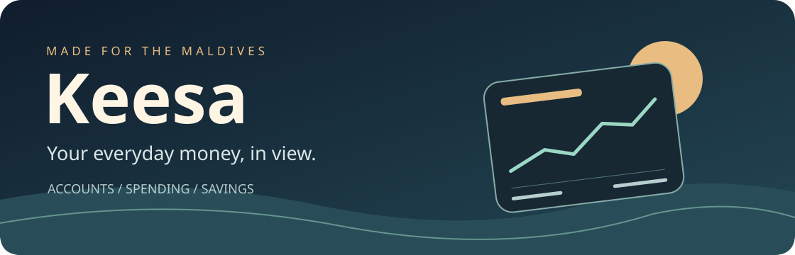
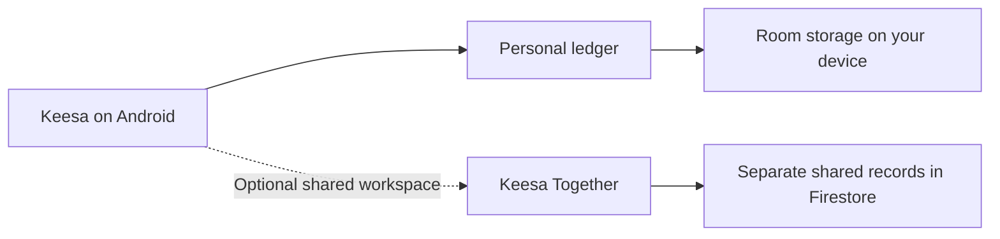

  

  

  <a href="#inside-keesa"><strong>Explore the app</strong></a> ·
  <a href="#release-tracks"><strong>Release tracks</strong></a> ·
  <a href="#install-a-pilot"><strong>Install a pilot</strong></a> ·
  <a href="#development-tracker"><strong>Development tracker</strong></a>

## Inside Keesa

Keesa brings bank accounts, cash wallets, savings goals, and upcoming payments into one Android ledger built for the Maldives. See what you can spend after setting money aside, and follow your finances in **MVR, USD, or a combined view**.

| **Track your money** | **Plan ahead** | **Share with a partner** |
| :--- | :--- | :--- |
| [Accounts, transfers, receipts, and bank SMS](#accounts-and-everyday-ledger) | [Budgets, goals, bills, and financing](#planning-and-insights) | [Private and joint finances in Keesa Together](#keesa-together) |

> **Harbour Lights · 2.38.1** — Use the regular plus menu for everyday transactions and a dedicated airplane button for Journey Actions.

### Accounts and everyday ledger

- **Bank accounts and wallets.** Open an account’s balance from Home, choose MVR-only or combined MVR + USD for the main spendable amount, and set a custom conversion rate. Historical transactions retain their recorded rate.
- **Income, expenses, and transfers.** Move money between your own accounts without counting it as income or spending. For cross-currency transfers, record the actual amounts sent and received and keep the resulting exchange rate.
- **Top Up and Adjust Balance.** Distinguish new income from funds you already held. Reconcile an account to its actual balance with a dated correction and a reason, preserving the original ledger and keeping the correction out of income and spending reports.
- **Receipts and beneficiaries.** Attach receipt images, split a purchase across categories, and view the income and expenses linked to each beneficiary. Record income from a beneficiary directly into one of your accounts.
- **MIB bank slips.** Import an image or PDF, take a photo, or share a slip from another Android app. Confirm the source account and payment details. Keesa keeps the original slip on the importing device and checks matching Favara SMS references.
- **Backdated entries.** Select the actual transaction date and approve each past-date save explicitly. Unchanged old edits retain their timestamp, and draft approval is never reused.
- **Beneficiary histories.** Copy an unmasked account number, inspect familiar ledger rows and open payment details over the same profile. Gross income and expense totals retain MVR/USD separately, excluding transfers and principal.
- **Ledger housekeeping.** Archive entries to hide them from the active ledger while retaining their financial effect. Trash and refund actions are available for eligible transactions.

<strong>Bank SMS, BML notifications and private review</strong>

With permission, Keesa parses supported bank SMS and BML Banking / BML Mobile Funds Received and Favara Funds Sent notifications on the device. Notification access is optional and explained separately. Choose automatic posting or review alerts yourself, individually or in bulk. New alerts are the default, with an optional scan from a date you select. You can choose a default account and whether bank-account matching takes priority. An outgoing transfer can debit its source while the destination remains pending, then be completed from the ledger.

### Planning and insights

| Feature | What you can do |
| :--- | :--- |
| **Budgets and spending envelopes** | Set monthly limits by category, track what you’ve used, and see what’s left. Split receipts count toward the categories you assigned. |
| **Goal Vaults** | Account-backed reservations with contribution/withdrawal history, a dashboard, categories, priorities, target dates, images, optional schedules and lifecycle controls. Personal or shared ownership keeps spendable money separate. Allocate salary toward goals, envelopes, or other accounts. |
| **Subscriptions and commitments** | View upcoming payments in a calendar or list, check daily agendas and payment status, and log subscription renewals when you pay. |
| **Loans and financing** | Track facilities, due dates, linked debit accounts, and repayments. Use conventional APR or Murabaha calculations when setting up a facility and maintain the outstanding balance manually. |
| **Spending Compass** | Overview, Analytics, Budgets and Insights; selected dates, MVR/USD/combined spending, ranked categories and daily/weekly/monthly trends. Monthly category limits keep their MVR basis. Open supporting transactions; Personal and Together analytics stay separate. |
| **Optional notifications** | Get on-device alerts for budget thresholds, upcoming subscriptions, unusual spending, and goal milestones. Unusual-spending alerts use your local history when enough is available. |
| **Official Keesa messages** | Opt in to announcements, maintenance, app updates, security and information. Contextual in-app messages and their Analytics setting have separate consent. |

### Keesa Roam

Open **Settings → Keesa Roam → Open Journeys** from Personal or Together. You can also enable the Roam card in Dashboard Layout. Tap a Journey card for swipeable balances, a wallet carousel, Trip pulse and recent activity. The Ledger tab follows the selected Journey. Use the **airplane button** for trip actions and the **plus button** for regular Income, Expense and Transfer. Choose **Exit Journey** to return to your regular dashboard and ledger. Start and pause live in **Manage Journey**.

| Feature | What you can do |
| :--- | :--- |
| **Set up a trip** | Choose a country and reporting currency, add destinations, set optional dates and customize trip categories. Set budgets and make planning edits while paused. |
| **Fund and exchange travel cash** | Start with a USD wallet and add destination-currency wallets. Use **Transfer USD to Journey** to record funding from a USD account or wallet in the same space. Record exchanges using actual amounts, the booked rate and any separate fee. |
| **Journey Ledger** | Browse dated trip activity, search and filter by movement type, and open linked bank entries when available. Reconcile funding, returns and exchanges against the recorded wallet movements. |
| **Track the trip** | Trip pulse shows the remaining budget, planned days, a daily allowance and wallets that may be running low based on recent purchases. Record receipts and see spending by day, destination or category. |
| **Plan and share expenses** | Track estimates, prepaid bookings and refundable deposits. Link eligible bank entries to avoid a duplicate debit. Split purchases, record short-term lending and export a Journey statement. |
| **Review and complete** | Check cash to carry forward, unpaid loans and deposits. Retain leftover currencies and choose whether outstanding loans should be repaid in a different currency at a reviewed rate. |
| **Together readiness and history** | See whether shared Roam is waiting for partner setup, sync or confirmation. Review who made confirmed changes and when. Both partners should update and open Roam in Together. |

Delete an empty Journey or archive one with financial history. Travel cash stays part of total wealth and separate from everyday spendable funds. Keesa records movements that you carry out separately with your bank or exchange provider.

### Pilot updates

Keesa checks the public GitHub pilot channel about once a day, with a manual **Check for updates** action in **Settings → About Keesa**. See the version and release notes before downloading, follow download progress, and install through Android’s confirmation screen. Downloads are checked against their published SHA-256, package, version, and the installed signing certificate. Updates are optional. Dismissible reminders are spaced at least 24 hours apart and end when Keesa is up to date or the reminder sequence finishes.

The first updater-enabled build needs to be installed manually over the existing app. Android may ask you to allow Keesa to install unknown apps before a later update.

### Keesa Together

Keep your private finances and a two-person household workspace in one app. Switch between **Personal**, **Together**, and **All**. The combined view labels private and shared items and lets you filter by space.

- **Set up a workspace.** Sign in with an administrator-provided account. Use a password-reset link to choose your password and verify your email if requested. Create a workspace and generate an expiring invite code, or join your partner using their code. The inviting partner confirms the request. Public account sign-up is not available in Keesa.
- **Manage household finances.** Use shared accounts, transactions, beneficiaries, budgets, envelopes, Goal Vaults, subscriptions, a commitments calendar, loans, and spending reports. Either partner can add shared accounts after setup. Partner updates arrive while the app is in the foreground.
- **Share deliberately.** Publish a balance-neutral reference from a private transaction while keeping the original in your Personal ledger. A Personal-to-Together transfer instead moves money into a shared account and shows your partner the contributor, received amount, currency, and date. Your personal account details and private notes stay private. SMS transactions start in Personal.
- **Return to Personal.** Both partners must approve permanent workspace deletion when two people are connected. Once deletion is confirmed, Keesa returns to Personal and keeps your private records and email sign-in.

<strong>App lock, backups, and appearance</strong>

- **App lock.** Set a local PIN, configure inactivity locking, and enable fingerprint unlock on supported devices. The Danger Zone offers a separate PIN-confirmed option to clear this device’s Keesa data.
- **Backup and portability.** Export or import ledger data using CSV and JSON, export a readable statement, or restore a passphrase-encrypted vault. Personal vaults include available Journey receipts up to 24 MB. Other receipt files and device preferences remain separate. Together recovers supported shared records through sync; its receipt files stay on the importing device.
- **Keesa Living Themes.** Choose Maldivian heritage palettes with three authored colors, static or animated illustrations and optional coordinated card artwork. Preview and apply wallpaper and panel effects through Personalization Studio.
- **Keesa Signature Themes.** Preview Nocturne, Verdelune and Obsidian, or build a local theme with separate light and dark palettes and a static material finish. Save a theme independently and apply it to Personal, Together or All. Your previous look remains available.
- **Personalization controls.** Choose light, dark or system appearance, custom backgrounds, per-space icon collections, Home card order, Haptic Studio, Motion Preferences and Navigation Studio. Settings search finds controls inside nested categories.
- **Palm Canopy.** A sixteenth botanical tritone theme pairs original coconut-palm artwork with static or living wallpaper and optional continuous card shadows. Preview three intensity and three lighting choices; wallpaper/shadow animation stay independent and respect Motion/accessibility limits.
- **Guided setup and help.** Onboarding offers optional camera/gallery portraits and theme, matching wallpaper, motion and card-design previews before Apply. Help & FAQ in Settings explains complex financial and sharing flows. The optional expandable Spending Compass Home card starts off until enabled.
- **Private identity and shareable records.** Set a device-local profile photo, then choose whether transaction images include it or your name. Review sender/receiver details and optional fields before saving or sharing a plain, craft-decorated or illustrated static image. Portraits are not uploaded to Together.

<strong>Friends, family, companies & everyday payments</strong>

- **Interest-free lending and borrowing.** Enable the optional Friends & Family Home card to record new money lent or borrowed, follow amounts owed in both directions and log partial repayments. Personal and Together journals keep separate accounts and native currencies. Principal moves cash without inflating income or spending; reviewed links reuse an existing bank-imported payment instead of recording it twice. Optional beneficiary-profile summaries open the filtered journal and stay hidden when no history exists.
- **Companies & Services.** Keep regular providers separate from personal contacts. Browse 184 editable templates across Maldivian services, digital subscriptions and Hosting & Developer Services. Logos are bundled locally; adding a provider creates no payment or subscription. Favara, STELCO and MWSC are added once as private starter beneficiaries with configurable matching rules; existing matches and disabled choices are preserved.
- **Review existing beneficiary tags.** Preview unassigned Personal ledger matches, including archives, and approve individual or selected matches. Existing recipients and financial values are preserved.
- **Faster transaction assembly.** Search beneficiaries as you type a Title / Payee and select the intended recipient. Cautious auto-tagging leaves competing matches for review.
- **Private import receipts.** Optional Android notifications confirm automatically saved bank alerts. Generic summaries are the default; a tap opens the specific private record after unlock. Payment details are a separate opt-in.
- **Profile-aware transaction images.** Choose your profile or account/currency for the outgoing header, retain the actual sender/receiver direction and review privacy fields before sharing. Existing explicit identity exclusions remain respected.

Both Together partners should update before using shared borrowing. Shared money movements require an online confirmation; the journal offers recovery or cancellation when a result is interrupted.

## Development tracker

The [Keesa development tracker](https://keesa.ct.ws/) is the public home for project updates, releases, and community feedback.

  
  
  

  
  
  

## Release tracks

| Track | Version | Where to look |
| :--- | :--- | :--- |
| **Device pilot** | **2.40.0 · Island Crossing** | [Pilot APK and release notes](https://github.com/solah438-hub/Keesa/releases/tag/v2.40.0-pilot) |

<strong>What changed in Harbour Lights</strong>

- **Regular transactions** are available from the usual plus menu on Journey Home and Ledger.
- **Journey Actions** opens from a dedicated airplane button. The finance space switcher remains available in the main navigation when Together is connected.
- **Roam screens** use Keesa’s themed cards, form layout and accessible Back control. **Help & FAQ → Travel & Roam** explains both action buttons.

## Where the data lives

> [!NOTE]
> Keesa Together is optional. This repository distributes pilot APKs and update manifests. Application source, Firebase configuration, and build tools are maintained locally.

## Install a pilot

Download the APK from the numbered pilot release and install it over your existing Keesa app. Keep the existing installation in place to retain your records.

Starting with 2.7.0, Keesa can check for later pilots from **Settings → About Keesa → Check for updates**. The permanent channel manifest is published as the **pilot-manifest.json** asset on the **pilot-channel** release and points to the corresponding numbered APK.

Pilot builds are prepared locally. Test a new pilot on your own phone before distributing it to other test devices.

---

Created by Ahmed Solah · Built for the Maldives

