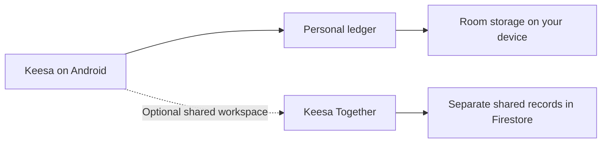

  

  

  <a href="#inside-keesa"><strong>Explore the app</strong></a> ·
  <a href="#release-tracks"><strong>Release tracks</strong></a> ·
  <a href="#install-a-pilot"><strong>Install a pilot</strong></a> ·
  <a href="#development-tracker"><strong>Development tracker</strong></a>

## Inside Keesa

Keesa brings bank accounts, cash wallets, savings goals, and upcoming payments into one Android ledger built for the Maldives. See what you can spend after setting money aside, and follow your finances in **MVR, USD, or a combined view**.

| **Track your money** | **Plan ahead** | **Share with a partner** |
| :--- | :--- | :--- |
| [Accounts, transfers, receipts, and bank SMS](#accounts-and-everyday-ledger) | [Budgets, goals, bills, and financing](#planning-and-insights) | [Private and joint finances in Keesa Together](#keesa-together) |

> **Kindred Ties · 2.26.0** — Interest-free Friends & Family lending, a Companies & Services catalogue, live beneficiary suggestions, clearer automatic-import receipts and profile-aware transaction images.

### Accounts and everyday ledger

- **Bank accounts and wallets.** Open an account’s balance from Home, choose MVR-only or combined MVR + USD for the main spendable amount, and set a custom conversion rate. Historical transactions retain their recorded rate.
- **Income, expenses, and transfers.** Move money between your own accounts without counting it as income or spending. For cross-currency transfers, record the actual amounts sent and received and keep the resulting exchange rate.
- **Top Up and Adjust Balance.** Distinguish new income from funds you already held. Reconcile an account to its actual balance with a dated correction and a reason, preserving the original ledger and keeping the correction out of income and spending reports.
- **Receipts and beneficiaries.** Attach receipt images, split a purchase across categories, and view the income and expenses linked to each beneficiary. Record income from a beneficiary directly into one of your accounts.
- **Ledger housekeeping.** Archive entries to hide them from the active ledger while retaining their financial effect. Trash and refund actions are available for eligible transactions.

<strong>Bank SMS, BML notifications and private review</strong>

With permission, Keesa parses supported bank SMS and BML Banking / BML Mobile Funds Received and Favara Funds Sent notifications on the device. Notification access is optional and explained separately. Choose automatic posting or review alerts yourself, individually or in bulk. New alerts are the default, with an optional scan from a date you select. You can choose a default account and whether bank-account matching takes priority. An outgoing transfer can debit its source while the destination remains pending, then be completed from the ledger.

### Planning and insights

| Feature | What you can do |
| :--- | :--- |
| **Budgets and spending envelopes** | Set monthly limits by category, track what you’ve used, and see what’s left. Split receipts count toward the categories you assigned. |
| **Goal Vaults** | Account-backed reservations with contribution/withdrawal history, a dashboard, categories, priorities, target dates, images, optional schedules and lifecycle controls. Personal or shared ownership keeps spendable money separate. Allocate salary toward goals, envelopes, or other accounts. |
| **Subscriptions and commitments** | View upcoming payments in a calendar or list, check daily agendas and payment status, and log subscription renewals when you pay. |
| **Loans and financing** | Track facilities, due dates, linked debit accounts, and repayments. Use conventional APR or Murabaha calculations when setting up a facility and maintain the outstanding balance manually. |
| **Spending Compass** | Overview, Analytics, Budgets and Insights; selected dates, MVR/USD/combined spending, ranked categories and daily/weekly/monthly trends. Monthly category limits keep their MVR basis. Open supporting transactions; Personal and Together analytics stay separate. |
| **Optional notifications** | Get on-device alerts for budget thresholds, upcoming subscriptions, unusual spending, and goal milestones. Unusual-spending alerts use your local history when enough is available. |

### Pilot updates

Keesa checks the public GitHub pilot channel about once a day, with a manual **Check for updates** action in **Settings → About Keesa**. See the version and release notes before downloading, follow download progress, and install through Android’s confirmation screen. Downloads are checked against their published SHA-256, package, version, and the installed signing certificate. Updates are optional, and dismissed versions stay dismissed during automatic checks.

The first updater-enabled build needs to be installed manually over the existing app. Android may ask you to allow Keesa to install unknown apps before a later update.

### Keesa Together

Keep your private finances and a two-person household workspace in one app. Switch between **Personal**, **Together**, and **All**. The combined view labels private and shared items and lets you filter by space.

- **Set up a workspace.** Sign in with an administrator-provided account. Use a password-reset link to choose your password and verify your email if requested. Create a workspace and generate an expiring invite code, or join your partner using their code. The inviting partner confirms the request. Public account sign-up is not available in Keesa.
- **Manage household finances.** Use shared accounts, transactions, beneficiaries, budgets, envelopes, Goal Vaults, subscriptions, a commitments calendar, loans, and spending reports. Either partner can add shared accounts after setup. Partner updates arrive while the app is in the foreground.
- **Share deliberately.** Publish a balance-neutral reference from a private transaction while keeping the original in your Personal ledger. A Personal-to-Together transfer instead moves money into a shared account and shows your partner the contributor, received amount, currency, and date. Your personal account details and private notes stay private. SMS transactions start in Personal.
- **Return to Personal.** Both partners must approve permanent workspace deletion when two people are connected. Once deletion is confirmed, Keesa returns to Personal and keeps your private records and email sign-in.

<strong>App lock, backups, and appearance</strong>

- **App lock.** Set a local PIN, configure inactivity locking, and enable fingerprint unlock on supported devices. The Danger Zone offers a separate PIN-confirmed option to clear this device’s Keesa data.
- **Backup and portability.** Export or import ledger data using CSV and JSON, export a readable financial statement, or use a passphrase-encrypted vault to back up and restore the financial database. Receipt images and app preferences are stored separately from the vault backup.
- **Make it yours.** Open Personalization Studio for light/dark/system appearance, Maldivian craft and heritage tritone palettes, static or living wallpapers, custom images, saved looks, per-space icon collections, Home card ordering, Haptic Studio, device-wide Motion Preferences and per-space Navigation Studio. Search nested Settings to find individual controls. Legacy and first-ten palettes receive Dhoani once in 2.24.0; the latest five heritage selections and unrelated preferences stay intact. Themes use three fixed colors. Optional card artwork, entry-panel decorations and their independent motion controls stay under Preview and Apply.
- **Guided setup and help.** Onboarding offers optional camera/gallery portraits and theme, matching wallpaper, motion and card-design previews before Apply. Help & FAQ in Settings explains complex financial and sharing flows. The optional expandable Spending Compass Home card starts off until enabled.
- **Private identity and shareable records.** Set a device-local profile photo, then choose whether transaction images include it or your name. Review sender/receiver details and optional fields before saving or sharing a plain, craft-decorated or illustrated static image. Portraits are not uploaded to Together.

<strong>Friends, family, companies & everyday payments</strong>

- **Interest-free lending.** Enable the optional Friends & Family Home card to record new loans, follow what is owed to you and log partial repayments. Personal and Together journals keep their own accounts and native currencies. Principal moves cash without inflating income or spending; reviewed links reuse an existing bank-imported payment instead of recording it twice.
- **Companies & Services.** Keep regular providers separate from personal contacts. Browse 184 editable, add-as-needed templates across Maldivian services, digital subscriptions and Hosting & Developer Services. Logos are bundled locally; adding a provider creates no payment or subscription.
- **Faster transaction assembly.** Search beneficiaries as you type a Title / Payee and select the intended recipient. Cautious auto-tagging leaves competing matches for review.
- **Private import receipts.** Optional Android notifications confirm automatically saved bank alerts. Generic summaries are the default; a tap opens the specific private record after unlock. Payment details are a separate opt-in.
- **Profile-aware transaction images.** Choose your profile or account/currency for the outgoing header, retain the actual sender/receiver direction and review privacy fields before sharing. Existing explicit identity exclusions remain respected.

Both Together partners should update before using shared lending. Shared money movements require an online confirmation; the journal offers recovery or cancellation when a result is interrupted.

## Development tracker

The [Keesa development tracker](https://keesa.ct.ws/) is the public home for project updates, releases, and community feedback.

  
  
  

  
  
  

## Release tracks

| Track | Version | Where to look |
| :--- | :--- | :--- |
| **Device pilot** | **2.26.0 · Kindred Ties** | [Pilot APK and release notes](https://github.com/solah438-hub/Keesa/releases/tag/v2.26.0-pilot) |

<strong>What changed in Kindred Ties</strong>

**A clearer record of everyday trust.** Record interest-free money lent to friends and family, keep regular providers organised, and review bank imports with more confidence.

| Area | What changes |
| :--- | :--- |
| **Friends & Family** | Optional expandable Home card and a dedicated Personal/Together lending journal. Track new loans, partial repayments and native-currency amounts owed. |
| **Honest principal** | Account cash changes once; principal stays out of income/spending. Link an eligible existing payment instead of creating a second movement. |
| **Companies & Services** | Separate contacts from providers, with 184 editable starter templates and locally bundled logos, including Hosting & Developer Services. |
| **Beneficiary suggestions** | Find contacts while typing Title / Payee. Whole-word auto-tagging leaves conflicting matches unassigned for review. |
| **Import receipts** | Optional private native notifications after a saved SMS/BML import. Tap to open the exact private transaction after unlock. |
| **Transaction images** | Choose profile or account/currency outgoing headers; retain actual direction and existing explicit privacy choices. |
| **Compatibility & recovery** | Spending Compass stays visible when collapsed. Explicit database migration and protected shared operations preserve history; interrupted confirmations can be recovered or cancelled. |

New Home cards remain off until enabled. Shared lending requires online confirmation, and both Together partners should update before using it. Existing records, sessions and appearance choices are retained through the in-place update.

> Install over the existing app. No financial test records are bundled. Manual device and financial acceptance remain necessary before wider pilot distribution.

## Where the data lives

> [!NOTE]
> Keesa Together is optional. This repository distributes pilot APKs and update manifests. Application source, Firebase configuration, and build tools are maintained locally.

## Install a pilot

Download the APK from the numbered pilot release and install it over your existing Keesa app. Keep the existing installation in place to retain your records.

Starting with 2.7.0, Keesa can check for later pilots from **Settings → About Keesa → Check for updates**. The permanent channel manifest is published as the **pilot-manifest.json** asset on the **pilot-channel** release and points to the corresponding numbered APK.

Pilot builds are prepared locally. Test a new pilot on your own phone before distributing it to other test devices.

---

Created by Ahmed Solah · Built for the Maldives

